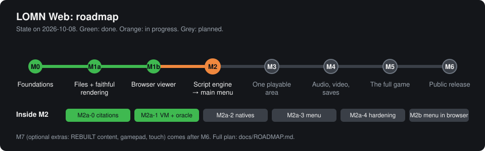
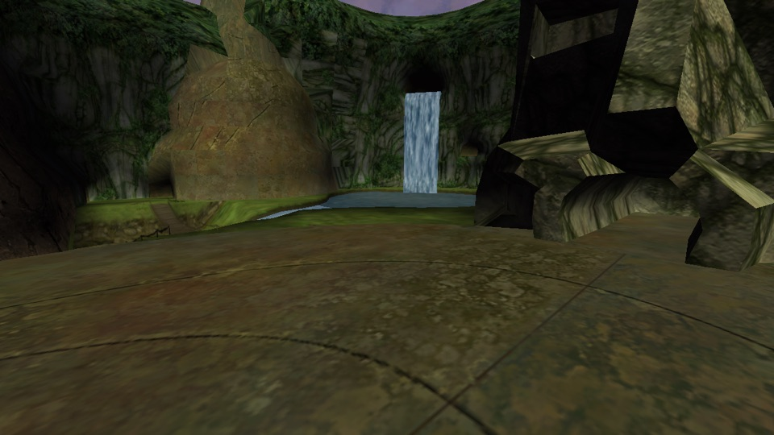
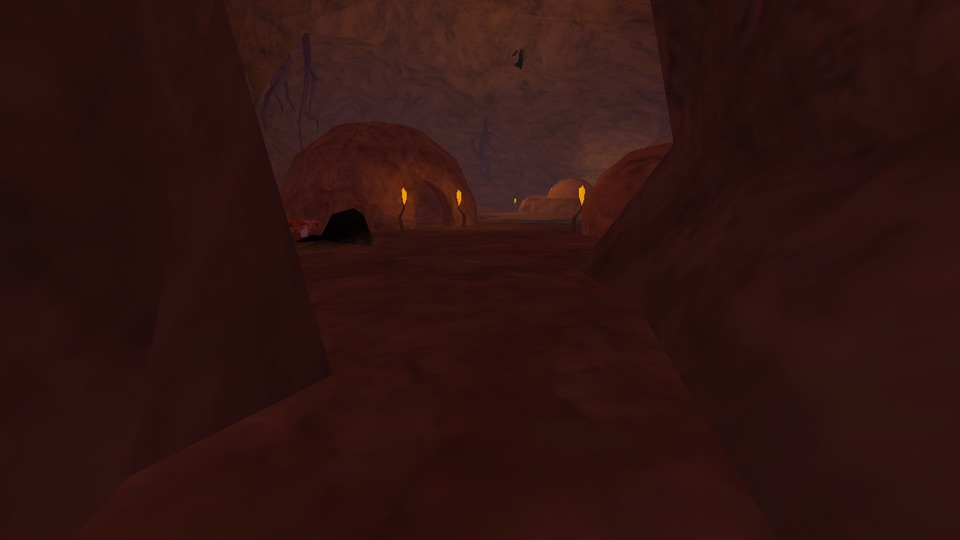
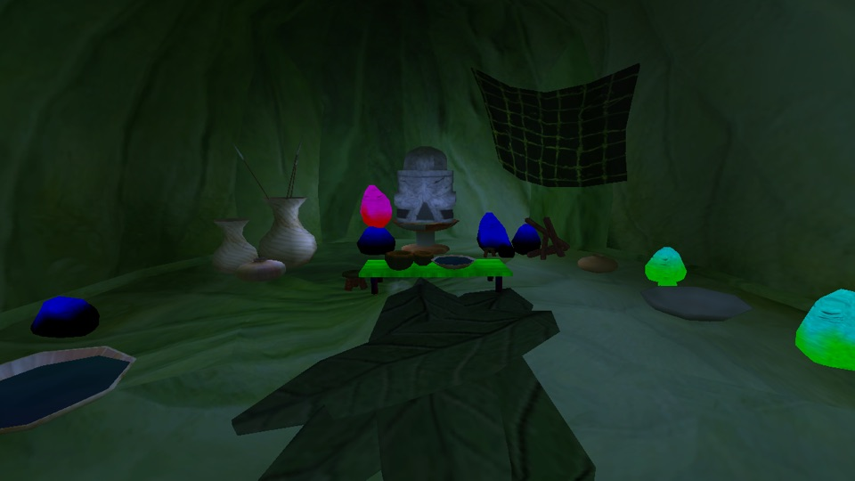

# LOMN Web

An unofficial, non-commercial fan project that brings **BIONICLE: The Legend of Mata Nui** (the cancelled 2001 PC game) to the web browser. You play from **your own copy** of the game files: the page reads them on your computer and never uploads them.

> **Not affiliated with or endorsed by the LEGO Group.** LEGO and BIONICLE are trademarks of the LEGO Group. The game, its art, models, music and story belong to their owners. This repository contains none of the game's files, only original code that reads them. The screenshots below are of the original game's content as rendered by this project, shown for documentation. Rights holders who want anything removed can open an issue, and we will remove it.



## Screenshots

These are rendered in the browser from the game's own files. Each one is pixel-identical to the project's native desktop build of the same scene.

| Waterfall plaza | Lava village | Inside a hut |
|---|---|---|
|  |  |  |

## What works today

- **Reading every game file.** BLK archives, SLB tables, `.x` models, DDS and TGA textures, and OSI script bytecode. Every reader is checked against an independent second implementation. Fuzzing ran 2,000,000 hostile inputs with 0 findings; it found and fixed 3 real bugs before that.
- **Faithful rendering of every area.** The game's own Direct3D 8 render states, fog from the game scripts, lighting and draw order run on WebGPU. An independent oracle agrees on all 123 areas.
- **A browser viewer.** Choose your game folder in Chrome, pick any of the 122 areas and fly around. In the real-data browser suite (60 of 60 checks):
  - the pages match the desktop build pixel for pixel;
  - the viewer holds a steady 60 fps;
  - GPU memory stays flat across 30 area switches;
  - areas load only the bytes they need;
  - a second visit loads instantly from a local copy.
- **The game's script engine, in progress.** The script VM is rewritten in C++ and, separately, in Python. The game's own `Base.osi` runs its setup and 600 frames with byte-identical traces in native C++, in WebAssembly and in Python. A 527-program conformance suite pins every one of the 96 instructions. Tests are proven to catch deliberately planted bugs (47 checked).

## What is left

| Next | What you get |
|---|---|
| **M2: the main menu** | The game's script runs until its real main menu shows in the browser, with fonts, HUD and keyboard. Steps left: native functions, the menu systems, hardening, and the browser boot. |
| **M3: one playable area** | Character, collision, camera and animation, checked against traces from the original game. |
| **M4** | Sound, cutscenes, and saves stored in the browser with export. |
| **M5** | The full game: every area, progression, bosses, AI. |
| **M6** | Browser matrix, performance, and a public URL. |
| **M7 (optional)** | Extras: REBUILT content, gamepad, touch. |

The full plan, with the exact next steps, open items and how to resume, is in **[docs/ROADMAP.md](docs/ROADMAP.md)**.

## How it works

1. **The original is read as data and never run.** The game's executable is decompiled offline with Ghidra: 6,940 functions, fully symbolised. Every behaviour we reproduce cites the original's code by address. The game's `.exe` and DLLs are never executed.
2. **The rewrite is clean C++17.** It compiles to native code and to WebAssembly, with WebGPU for graphics (Dawn on desktop, the browser's WebGPU on the web).
3. **Each piece is checked against a second implementation.** Every format reader and the script VM have an independently written oracle, usually in Python. Agreement is required byte for byte. Where both could share a misreading, the rule is checked against the original binary instead.
4. **You bring your own files.** The page reads your folder with the browser's file APIs and can keep a private copy in the browser's storage for fast revisits. Nothing is uploaded; the test suite checks every network request.

## Run it yourself

**Requirements:** macOS (Apple Silicon is the tested platform), Homebrew (`ninja`, `ghidra`, `openjdk@21`), Python 3, Node.js, and your own copy of LOMN Beta 1.5.0.

```bash
make setup
```
This installs the pinned toolchain into `.toolchain/`: emsdk, Dawn, emdawnwebgpu, doctest, and the Playwright Chromium for the browser tests. Every download is sha256-checked.

Create `.env.local` pointing at your game data:
```
LOMN_DATA=/path/to/lomn-data
```
The folder needs `install/` (the game folder, containing `LEGOBionicle.exe` and `data/`) and `reference/LEGOBionicle.exe`.

Build the browser viewer:
```bash
make site
```

Serve it locally, then open the printed address in Chrome and choose your game folder:
```bash
cd web && node -e "import('./tests/serve.mjs').then(async m=>{const s=await m.serve('../build/site');console.log(s.url)})"
```

Run every test layer (tools, native, wasm, browser):
```bash
make check
```

## Repository layout

| Path | Contents |
|---|---|
| `engine/` | the C++17 engine: formats, renderer, script VM; tests and tools |
| `web/` | the browser page, the worker, and browser tests |
| `tools/` | Python: decompiler pipeline, oracles, the OSI assembler and conformance tools |
| `tests/osi/conformance/` | the script VM conformance corpus (source only; nothing from the game) |
| `docs/` | roadmap, specs and plans, the OSI contracts (`docs/osi/`), research notes and audits (`docs/knowledge/`) |
| `data/osi/` | tables of the script engine's native functions: names, addresses and signatures, no code |

## Credits

- **The original game:** BIONICLE: The Legend of Mata Nui, developed by Saffire for the LEGO Group (cancelled in 2001).
- **The fan community** that preserved and restored the game as Beta 1.5.0 and kept BIONICLE alive.
- **Third-party components:** see [THIRD_PARTY.md](THIRD_PARTY.md).

## Licence

This project's own code and documentation are licensed under the [GNU General Public License v3.0](LICENSE). Third-party components keep their own licences ([THIRD_PARTY.md](THIRD_PARTY.md)). The game's content (data files, executable, art, music and text) belongs to the LEGO Group and its licensors. It is not covered by this licence and is never distributed here: every player supplies their own copy.
